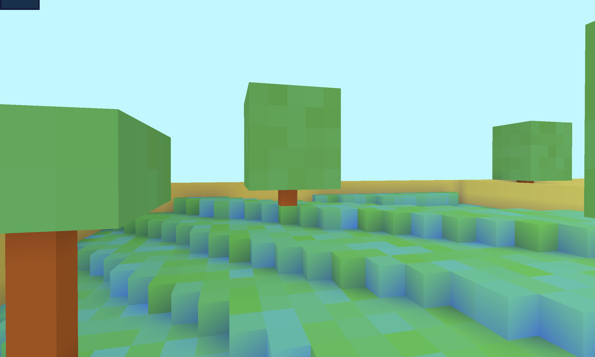
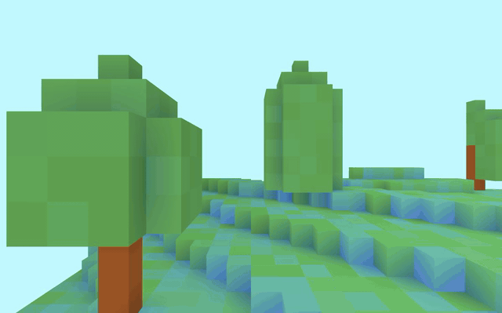
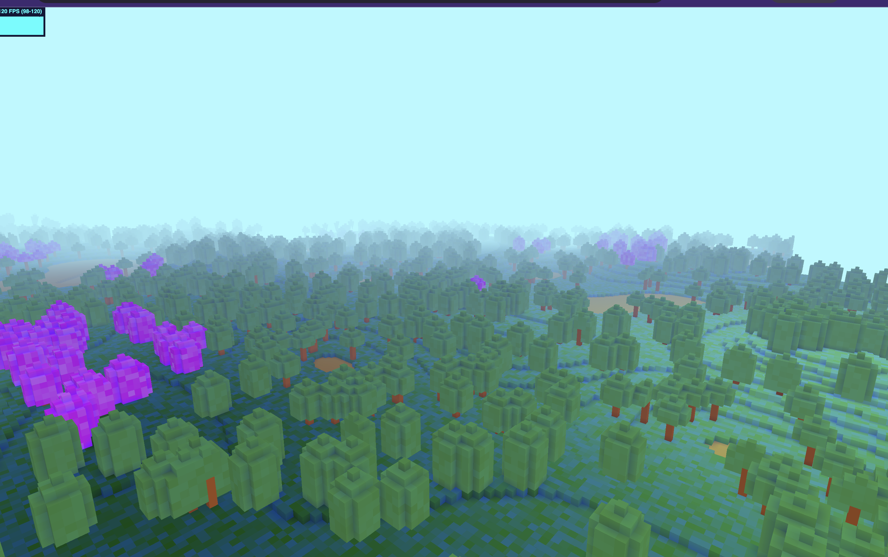
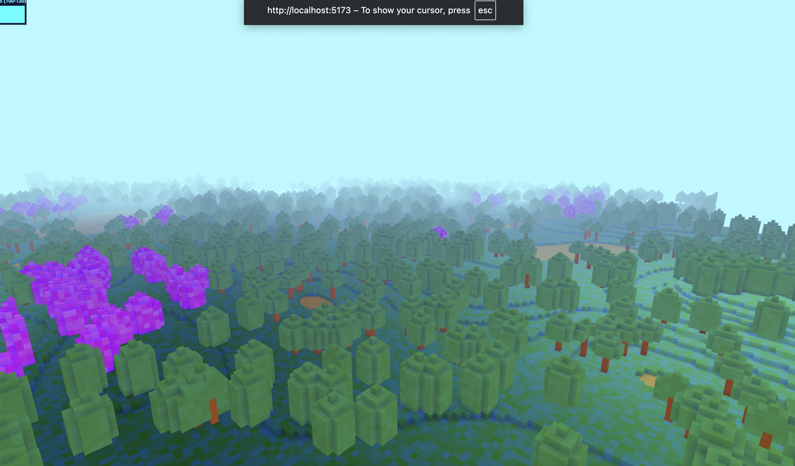
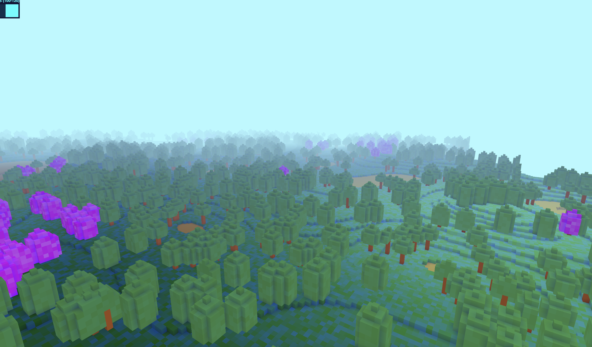
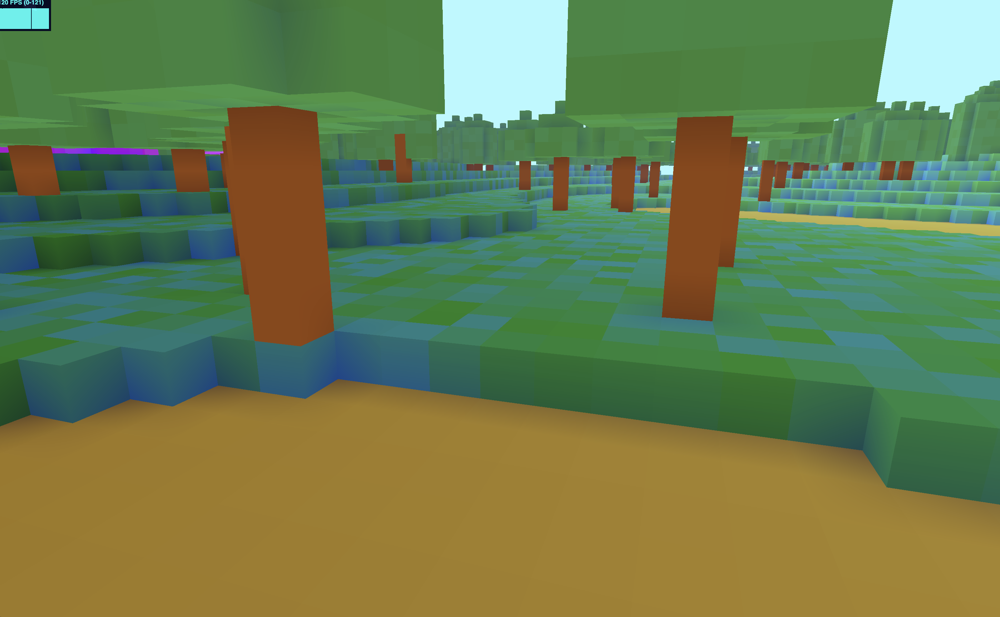

# cube-engine



A voxel engine prototype I built in three.js. It generates Minecraft-style terrain in chunks: hills with rivers, sandy shores, dirt and rock layers, trees. Each chunk becomes one mesh with only the visible faces, lit by baked ambient occlusion.



## Features

- Chunked voxel terrain (32×64×32 chunks) from layered, alea-seeded simplex noise: rivers, sand, dirt, rock, trees with green or purple leaves
- Chunk streaming: new chunks generate around the camera as you fly
- Per-chunk face culling, so only visible faces get meshed
- Per-vertex ambient occlusion (the 8-neighbor corner rule), custom shader with fog
- Flying camera with pointer-lock mouse look

## Getting started

```bash
npm install
npm run dev
```

No shader build step, Vite serves everything.

Click to lock the pointer, then:

- `WASD` — move
- `Space` / `Ctrl` — up / down
- `Shift` — 3× speed
- `Esc` — release the pointer

## How it's put together

The frame loop and renderer setup live in `src/engine`, including a forked `PointerLockControls` (`src/engine/pointer.ts`). Everything world-related is in `src/world`: the noise-based chunk generator, the face-culling and AO tables, the mesher. Chunk generation was designed to run on a worker pool (`chunk-builder.worker.ts` + `WorkerPool`), but right now the simple in-process pool (`src/world/chunk-pool`) is what actually runs.

## Gallery

Over the forest:



No seams between streamed chunks:



Down in the canopies:



Under the leaves, where sand meets grass:



## Status

A prototype, not a game:

- The threaded worker pool is written, but the simple pool is the one running
- No collision or physics — you fly through blocks
